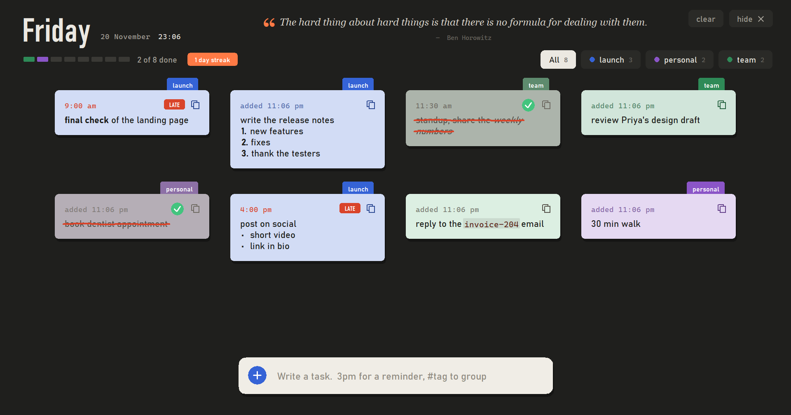

# Desk Board

**Your to-do list, as your desktop wallpaper.**

Desk Board turns your desktop into a board of task cards. It sits behind all your windows like a wallpaper, so your tasks are there every time you look at the desktop. Write a task, drag it around, click it when it's done. Each morning you get a fresh board, and anything unfinished comes with you.



- **Light:** one small Python file, no extra packages, about 40 MB of memory.
- **Private:** everything stays on your computer in plain files. No account, no internet.
- **Windows 10 and 11.**

---

## Install (2 minutes)

1. **Install Python 3** from [python.org/downloads](https://www.python.org/downloads/). In the installer, tick **"Add python.exe to PATH"**.
2. **Download Desk Board:** click the green **Code** button above, then **Download ZIP**, and unzip it somewhere it can stay (for example `Documents\desk-board`).
3. **Double-click `install.cmd`.**

That's it. Desk Board opens now, appears in your Start menu, and starts by itself every time you sign in.

> Want it on the taskbar? Open the Start menu, right-click **Desk Board**, and choose **Pin to taskbar**.

---

## How to use it

| To do this | Do this |
|---|---|
| Add a task | Type in the box at the bottom and press **Enter** |
| Set a reminder | Start with a time: `3pm call the bank` or `14:30 send report` |
| Group tasks | Add a tag anywhere: `#work`, `#home` |
| Mark it done | **Click** the card (click again to undo) |
| Move it | **Drag** the card |
| Edit it | **Double-click** the card |
| Delete it | **Right-click** the card (an **Undo** button appears) |
| Copy it | Click the small copy icon on the card |
| Add an image | Copy a screenshot and press **Ctrl + V** in the box |
| Show one group | Click a tag at the top right |
| See it over your windows | Press **Alt + `** (the key above Tab). **Esc** sends it back |
| Free up memory | Press **Alt + Shift + `**, or click **memory %** at the top right |
| More options | **Right-click** an empty spot on the board |
| See your progress from any app | The small **"2 of 5 done"** pill above the clock floats over every window; click it to bring the board up, click again to send it back (it steps aside for full-screen videos and games) |
| Tuck it away | Click **hide** at the top right (it keeps running; Alt + ` brings it back) |

### Formatting (like Slack)

| Type | Or press | You get |
|---|---|---|
| `*bold*` | Ctrl + B | **bold** |
| `_italic_` | Ctrl + I | *italic* |
| `~strike~` | Ctrl + Shift + X | ~~strike~~ |
| `` `code` `` | Ctrl + Shift + C | `code` |
| `1. ` at the start of a line | | numbered list |
| `- ` at the start of a line | | bullet list |

**Shift + Enter** starts a new line. In a list, **Tab** indents (1. becomes a.) and **Shift + Tab** goes back.

### Every day

- At midnight you get a new board. Unfinished cards move over and are marked "from yesterday".
- A **streak** counts the days in a row you finish at least one task.
- A new **quote** shows at the top each day. Edit `quotes.txt` to add your own (one per line: `quote | who said it`).
- **clear** at the top right removes finished cards or the whole board. **Undo** brings them back.

### Memory

The **memory** pill at the top right shows how full your RAM is. It turns amber at 75% and red at 90%. Click it to see the apps using the most memory, with all of Chrome's (or any app's) processes added together. **End** closes an app the normal way, like clicking its X, so it can still ask you to save. If the app doesn't close, the button becomes **Force quit**. Windows system processes are never listed, so you can't end something important by accident.

Browsers (Chrome, Edge, Brave, Vivaldi, Opera, Firefox) also list their **open tabs**, with the memory each tab uses when the browser reports it, and a **✕** to close a tab. Scroll the panel with the mouse wheel when the list is long.

### Add your AI assistant (optional)

Want a button for an assistant you use, like Instinct or ChatGPT? Add this to `settings.json` and restart Desk Board:

```json
"assistant": { "name": "Instinct", "url": "https://app.instinct.com/login" }
```

A button with that name appears at the top right and opens it. **Shift + right-click** a card and choose **Ask Instinct about this** to copy the task and open the assistant, ready to paste. Desk Board never sends anything by itself: nothing leaves your computer unless you paste it.

### Change the shortcuts

Open `settings.json` in the Desk Board folder and edit:

```json
"hotkeys": { "board": "Alt + `", "memory": "Alt + Shift + `" }
```

Use any mix of `Ctrl`, `Alt`, `Shift`, `Win` with a letter, number, `F1`–`F12` or `` ` ``, then restart Desk Board. Windows keeps a few for itself (Ctrl + Shift + Esc always opens Task Manager), so if a shortcut doesn't work, pick another.

---

## Where your data lives

Everything is in the Desk Board folder:

- `boards/`: one file per day (`2026-11-20.json`). Only the last few days are kept.
- `images/`: images you pasted.
- `settings.json`: tag colours, your filter and streak.

These are plain files: back them up, sync them, or delete them whenever you like.

## Uninstall

Double-click **`uninstall.cmd`**. It closes Desk Board and removes its shortcuts. Then delete the folder.

---

## FAQ

**Windows says "Windows protected your PC" when I run install.cmd.**
Click **More info**, then **Run anyway**. The script only creates two shortcuts; you can read it in `install.ps1`.

**Nothing happens when I run install.cmd.**
Python is probably missing or not on PATH. Reinstall Python and tick "Add python.exe to PATH".

**Show desktop (Win + D) hides it?**
It comes back by itself within a moment.

**Can it close by accident?**
No. Hide only tucks it away, Alt + F4 doesn't close it, and a tiny keeper process starts the board again within 2 seconds if it ever stops. Any error is written to `error.log` in the folder. To really stop it, run `uninstall.cmd` (or end both `pythonw` entries in Task Manager).

**Multiple monitors?**
It covers your main screen.

## How it works (for the curious)

It's one file, `board.pyw`, built on `tkinter` (bundled with Python). It uses a few Windows calls through `ctypes` to keep the window behind everything else and to register the Alt + ` hotkey. Pasting images uses a small PowerShell helper, `clip_image.ps1`, so no image libraries are needed. The memory panel lives in `procs.py`: plain Windows calls, no `psutil`. Browser tabs are read and closed by `tabs.ps1` through Windows UI Automation (what screen readers use), only while the panel is open.

Pull requests and ideas are welcome.

## License

[MIT](LICENSE)
